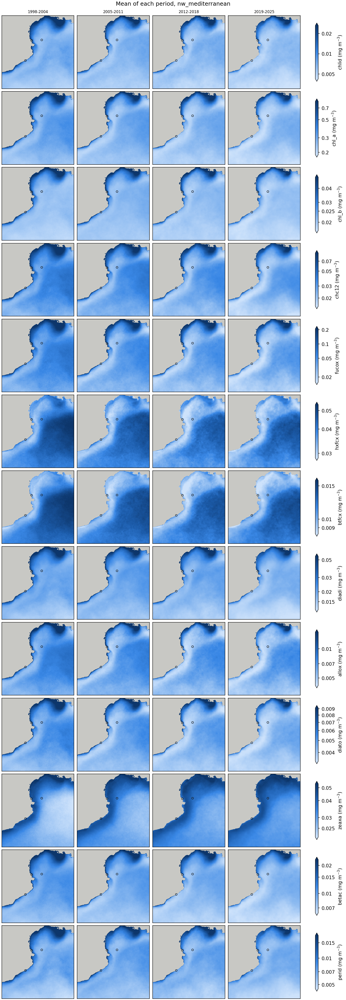
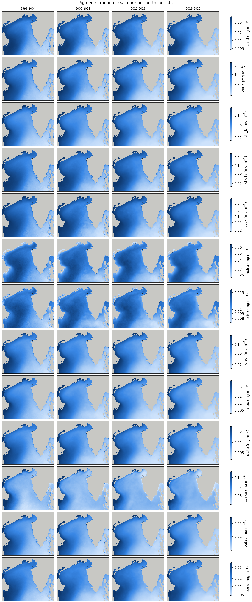
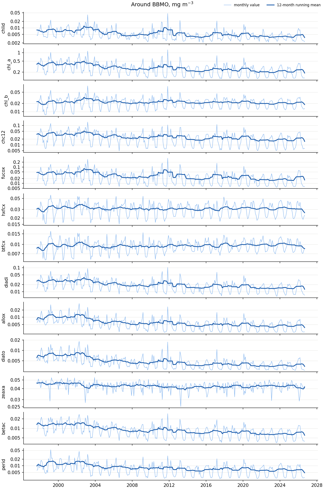
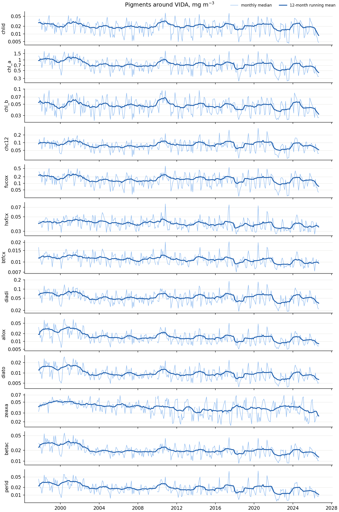
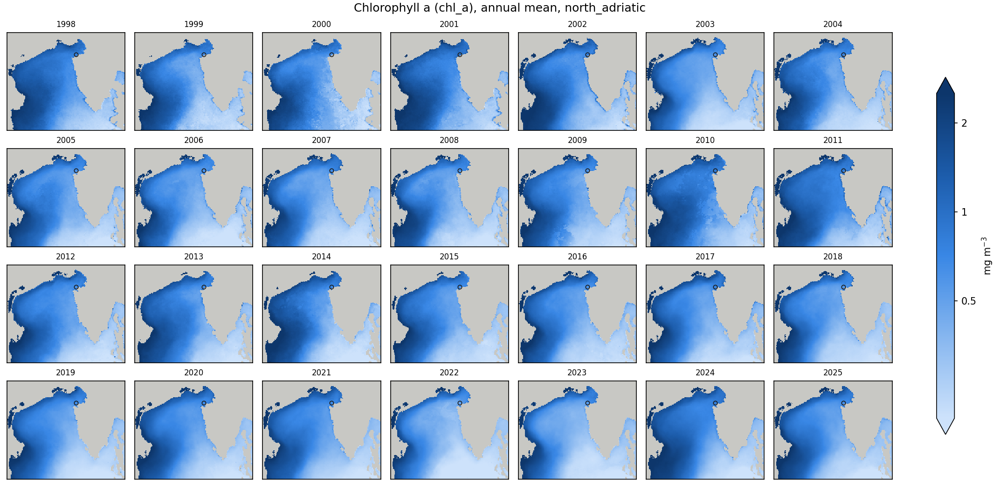
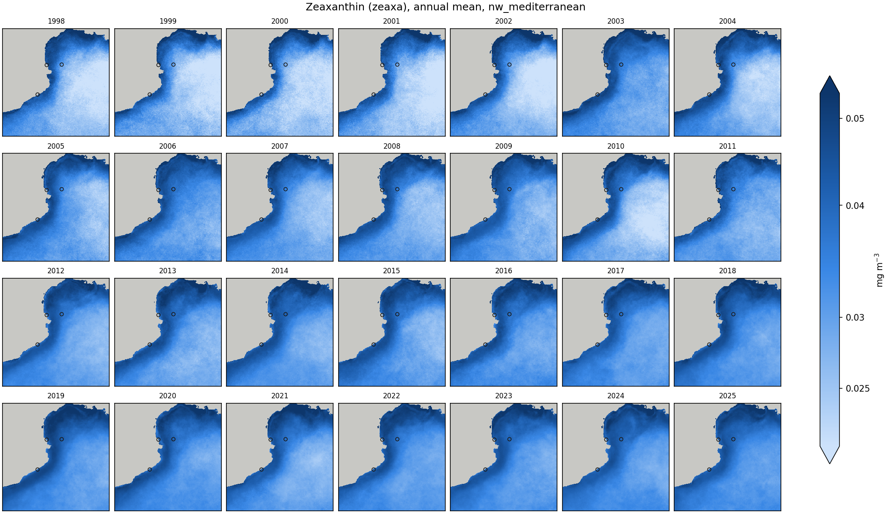

# DROPTHEMIC-MED

**Diversity and Responses Of Plankton: Tracking MIcrobial Community structure in the MEDiterranean
Sea — from Satellite to DNA.** An OYSTER (EuroMarine) Marine ECR Cooperation Project between the
Institut de Ciències del Mar (ICM-CSIC, Barcelona) and the Marine Biology Station Piran (NIB,
Slovenia).

The project links satellite ocean colour to plankton diversity in two steps, each learnt from
existing data:
1. remote sensing reflectance (Rrs) → photosynthetic pigments;
2. pigments → plankton groups from metabarcoding.

New DNA and pigment data from the Gulf of Trieste test the second step. Both models are then
applied to more than 25 years of satellite records of the Mediterranean.

| Task | Content | Status |
|---|---|---|
| [1](#task-1--from-radiometry-to-pigments) | Pigment concentrations from radiometry | Done: model and paper |
| [2](#task-2--from-pigments-to-plankton-diversity) | Plankton groups from pigments | To come |
| [3](#task-3--plankton-diversity-in-the-gulf-of-trieste) | New metabarcoding and pigment time series at VIDA | To come |
| [4](#task-4--25-years-of-satellite-records) | Satellite radiometry → pigments → diversity, 1997 to today | In progress |

## Installation

```bash
git clone https://github.com/Kissyfur/dropthemic-med.git
cd dropthemic-med
py -3.9 -m venv .venv               # Linux / macOS: python3.9 -m venv .venv
.venv\Scripts\activate              # Linux / macOS: source .venv/bin/activate
pip install -r requirements.txt
copernicusmarine login              # once, for the Copernicus Marine downloads
```

Python 3.9 and TensorFlow 2.10 are the versions of the Task 1 models; TensorFlow 2.10 is also the
last version with GPU support on Windows. The environment installs from GitHub:
- [pigment-retrieval-from-olci](https://github.com/Kissyfur/pigment-retrieval-from-olci) (Task 1),
  with its trained models;
- [copernicus-matchup](https://github.com/Kissyfur/copernicus-matchup), which downloads Copernicus
  Marine data and builds matchups.

Run the commands below from the repository root.

## Task 1 — From radiometry to pigments

A convolutional neural network estimates 13 phytoplankton pigments from Rrs, either at the 11 OLCI
bands or at the 5 bands of the multi-sensor record.

- Code and trained models: [pigment-retrieval-from-olci](https://github.com/Kissyfur/pigment-retrieval-from-olci),
  installed with the environment.
- Paper: Sánchez-López, B., Talone, M., Cerquides, J., Di Cicco, A., Martínez-Fornos, G. and Slavinec, P.
  (2026). Simultaneous retrieval of 13 phytoplankton pigments from Sentinel-3 OLCI using convolutional
  neural networks and transfer learning. *Frontiers in Remote Sensing*, 7.
  https://doi.org/10.3389/frsen.2026.1880618

## Task 2 — From pigments to plankton diversity

To come.

## Task 3 — Plankton diversity in the Gulf of Trieste

To come.

## Task 4 — 25 years of satellite records

For now this covers two areas around the sampling stations, not the whole Mediterranean:

| Region | Box | Stations |
|---|---|---|
| `north_adriatic` | 44.50–45.85 N, 12.20–14.50 E | VIDA (Piran) |
| `nw_mediterranean` | 40.50–43.50 N, 1.50–5.50 E | BBMO (Blanes), SOLA and MOLA (Banyuls-sur-Mer) |

The data go to `task4/data/` and the figures to `task4/figures/`, neither kept in git.

**1. Monthly radiometry.** Each month's mean of the daily 1 km multi-sensor Rrs, from September
1997 to today, floored at its 5% quantile and log-transformed:

```bash
python task4/scripts/download_monthly_means.py task4/configs/med_radiometry_monthly.yaml
```

This writes `task4/data/radiometry_monthly/<region>_monthly.nc`. The first run downloads about
33 GB. It resumes if interrupted, and later runs only fetch the newest months.

**2. Daily station cubes.** A cube around each station for every day of the record, built with
copernicus-matchup like the training matchups:

```bash
python task4/scripts/station_matchups.py task4/configs/station_matchups.yaml
```

This writes `task4/data/station_matchups/datasets/`.

**3. Pigments.** The Task 1 model for the 5 multi-sensor bands (`multi_sat_ft/concatenatedCNN`),
on the monthly maps and on the station cubes:

```bash
python task4/scripts/predict_pigments.py
```

This writes the 13 pigments, in mg m⁻³, to `task4/data/pigments/`:
- `<region>_monthly.nc`, on the (time, latitude, longitude) grid of the monthly radiometry, with
  its `valid_days`. Means of one or two days can be unrealistic: filter on `valid_days`.
- `stations_daily.nc`, as (station, time, lat_pixel, lon_pixel): the 11 × 9 pixels of about 1 km
  around each station, every day from 30 September 1997 to two weeks before the end of the record.
  Only the pixels with a satellite retrieval that day are predicted, not the gaps that the cubes
  fill by interpolation.

`--only monthly` or `--only stations` predicts one of the two. For other files, the environment
also has the `predict-pigments` command of Task 1 (see its README).

**4. Figures.** Maps and station series of the pigments, for a first look before the diversity
analysis:

```bash
python task4/scripts/pigment_figures.py
```

This writes to `task4/figures/`:
- `<region>/<pigment>_years.png`: the mean of each complete year (1998–2025), one map per year;
- `<region>/periods.png`: every pigment (rows) averaged over four periods of about seven years
  (columns);
- `stations/<station>.png`: one panel per pigment, with the median of each month over the pixels
  around the station and its 12-month running mean.

Months with fewer than 3 days of data are left out. All the maps of a pigment share one log colour
scale. The record joins several sensors (SeaWiFS, MODIS, VIIRS, OLCI), so a change between years
can come from a change of sensor rather than of the plankton.

### Analysis

A first look at the pigments before computing diversity indicators from them, compared with the
literature. The figures are copies of those of step 4, in `task4/report/`. Trends are log-linear
fits of the annual values from 2003 to 2025 (see point 6 for why 2003).

**1. The 13 pigments carry two signals.** In both regions, one principal component of the monthly
maps, with all pigments rising and falling with chlorophyll a, explains 81–83% of the variance. A
second one, 19'-hexanoyloxy- and 19'-butanoyloxyfucoxanthin against zeaxanthin, explains 12–14%,
and the other eleven 4–5%. This is about all that multispectral ocean colour can give: satellite
reflectances hold about two independent quantities, and the products derived from them one (Cael
et al., 2023), and in situ most diagnostic pigments follow chlorophyll a too (Hirata et al.,
2011). Diversity indicators computed from these pigments will mostly re-express chlorophyll a plus
one axis of composition, a caution that Martínez-Fornos et al. (2026) also make for their
satellite Shannon index.

**2. Diatoms on the coast, haptophytes and cyanobacteria offshore.** The share of fucoxanthin in
chlorophyll a is 3.2 times higher in the most productive waters (top 10% of chlorophyll a) than in
the least productive ones in the north Adriatic, and 2.2 times in the NW Mediterranean. Offshore,
the shares of 19'-hexanoyloxyfucoxanthin (7 and 2.4 times higher), 19'-butanoyloxyfucoxanthin and
zeaxanthin (4.7 and 2.3 times) are higher, zeaxanthin and 19'-hexanoyloxyfucoxanthin become the
main pigments after chlorophyll a, and in the NW Mediterranean the haptophyte and pelagophyte
pigments hardly follow chlorophyll a (r = 0.18 and −0.09). This matches the in situ picture: diatoms make the blooms
(Nunes et al., 2018), and haptophytes and prokaryotes are the main groups of the open
Mediterranean (Martínez-Fornos et al., 2026).

<p>
  
  
</p>

*The 13 pigments over four periods, NW Mediterranean (left) and north Adriatic (right). Circles
are the stations.*

**3. Late-winter bloom in Catalonia, autumn maximum in the Gulf of Trieste.** At BBMO, SOLA and
MOLA almost every pigment peaks between January and March and is lowest in July–August, except
zeaxanthin. Fucoxanthin varies 4 to 16 times over the year, zeaxanthin only 1.2 to 1.4 times
(peak in May), so the zeaxanthin share of chlorophyll a triples in summer (BBMO 0.11 → 0.32) while
the fucoxanthin share halves. The BBMO HPLC series shows the same winter–spring maxima and summer
minima (Nunes et al., 2018). At VIDA the haptophyte, dinoflagellate and diadinoxanthin pigments
peak in May, like the spring bloom of the Gulf of Trieste (Cerino et al., 2019), but chlorophyll a
and fucoxanthin peak in November, when the in situ counts rise only slightly. That autumn maximum
may be river water (sediment, coloured dissolved matter) read as pigment by the 5-band model: the
VIDA data of Task 3 can test it.

<p>
  
  
</p>

*Monthly pigments around BBMO (left) and VIDA (right), with their 12-month running mean.*

**4. NW Mediterranean: less chlorophyll, fewer diatoms, more cyanobacteria.** From 2003 to 2025
the regional chlorophyll a falls 8% per decade and fucoxanthin 18% (significant in 72% and 71% of
the pixels), while zeaxanthin rises 5% per decade (69% of the pixels). Relative to chlorophyll a,
zeaxanthin rises 16% per decade and 19'-hexanoyloxyfucoxanthin 6%, and fucoxanthin falls 10%. The
decline is gradual from about 2010, not a step. At BBMO, chlorophyll a falls 20% per decade and
fucoxanthin 33%. Satellite functional types over 2000–2025 give the same picture: chlorophyll
declining in all regions but the north Adriatic, most in the west, with falling shares of diatoms
and rising shares of prokaryotes and haptophytes (Martínez-Fornos et al., 2026). So does the BBMO
HPLC series, where most groups decrease as nutrients decrease (Nunes et al., 2018). One
disagreement: Martínez-Fornos et al. find green algae falling, while the share of chlorophyll b
here rises slightly (4% per decade).

**5. North Adriatic: years set by the Po, no trend.** The regional chlorophyll a varies from 0.40
to 0.93 mg m⁻³ between years, with all pigments together (median correlation 0.96) except
zeaxanthin. The lowest years, 2022, 2023, 2007 and 2003, include the two severe Po droughts of 2003
and 2022, and the highest are 2001, 1998, 2010, 2011 and 2024: satellite chlorophyll here follows
the Po discharge (Vona et al., 2025). From 2003 to 2025 there is no significant trend (chlorophyll
a −3% per decade, p = 0.6), as Martínez-Fornos et al. (2026) also find. The oligotrophication of
the north Adriatic measured in situ (Mozetič et al., 2010) was strongest in the decade to 2007, so
part of the drop between 1998–2002 and 2003–2007 here may be real. Only zeaxanthin rises (+4% per
decade, p = 0.001).

<p align="center">
  
</p>

*Annual mean chlorophyll a in the north Adriatic: the Po plume, strong in 2001, 2010 and 2024 and
weak in 2003 and 2022.*

**6. What the model and the record do.**
- *A step in 2002–2003.* From 1998–2002 to 2003–2007, chlorophyll a drops 13–30% at the four
  stations (alloxanthin up to 47%), and offshore zeaxanthin jumps in both regions (+17% for the
  regional median in the NW Mediterranean). It coincides with MODIS-Aqua and MERIS joining SeaWiFS, despite the inter-sensor
  correction of the product (Volpe et al., 2019), so the trends above start in 2003.
- *A floor near 0.1 mg m⁻³.* The model never gives chlorophyll a below about 0.1 mg m⁻³, while the
  most oligotrophic Mediterranean averages 0.06 mg m⁻³ (Martínez-Fornos et al., 2026): clear
  summer waters are overestimated and their trends damped.
- *Few clear coastal pixels.* There are satellite data on 13% of the pixel-days around SOLA and 17%
  around BBMO, against 27% at VIDA and 50% at MOLA. VIDA is at the Vida buoy (45.5488 N, 13.5505
  E); ps_mtag.csv rounds it to 45.5 N, 13.6 E, which is on land.

<p align="center">
  
</p>

*Annual mean zeaxanthin in the NW Mediterranean: the offshore step between 2002 and 2003, then
the rise.*

#### References

- Cael, B. B., Bisson, K., Boss, E. and Erickson, Z. K. (2023). How many independent quantities can
  be extracted from ocean color? *Limnology and Oceanography Letters*, 8(4), 603–610.
  https://doi.org/10.1002/lol2.10319
- Cerino, F. et al. (2019). Phytoplankton temporal dynamics in the coastal waters of the
  north-eastern Adriatic Sea (Mediterranean Sea) from 2010 to 2017. *Nature Conservation*, 34,
  343–372. https://doi.org/10.3897/natureconservation.34.30720
- Hirata, T. et al. (2011). Synoptic relationships between surface Chlorophyll-a and diagnostic
  pigments specific to phytoplankton functional types. *Biogeosciences*, 8, 311–327.
  https://doi.org/10.5194/bg-8-311-2011
- Martínez-Fornos, G., Di Cicco, A., Talone, M. and Berdalet, E. (2026). Trends of the
  phytoplankton functional diversity in the last 25 years in the Mediterranean Sea surface waters
  from satellite remote sensing. *Frontiers in Marine Science*, 13.
  https://doi.org/10.3389/fmars.2026.1892918
- Mozetič, P. et al. (2010). Recent trends towards oligotrophication of the northern Adriatic:
  evidence from chlorophyll a time series. *Estuaries and Coasts*, 33, 362–375.
  https://doi.org/10.1007/s12237-009-9191-7
- Nunes, S., Latasa, M., Gasol, J. M. and Estrada, M. (2018). Seasonal and interannual variability
  of phytoplankton community structure in a Mediterranean coastal site. *Marine Ecology Progress
  Series*, 592, 57–75. https://www.int-res.com/abstracts/meps/v592/p57-75/
- Volpe, G. et al. (2019). Mediterranean ocean colour Level 3 operational multi-sensor processing.
  *Ocean Science*, 15, 127–146. https://doi.org/10.5194/os-15-127-2019
- Vona, I., Colella, S., Sammartino, M., Brando, V. E. and Falcini, F. (2025). Positive correlation
  between the Po River discharge and ocean colour trends of Chl and TSM in the Adriatic Sea.
  *Frontiers in Remote Sensing*, 6. https://doi.org/10.3389/frsen.2025.1574347
