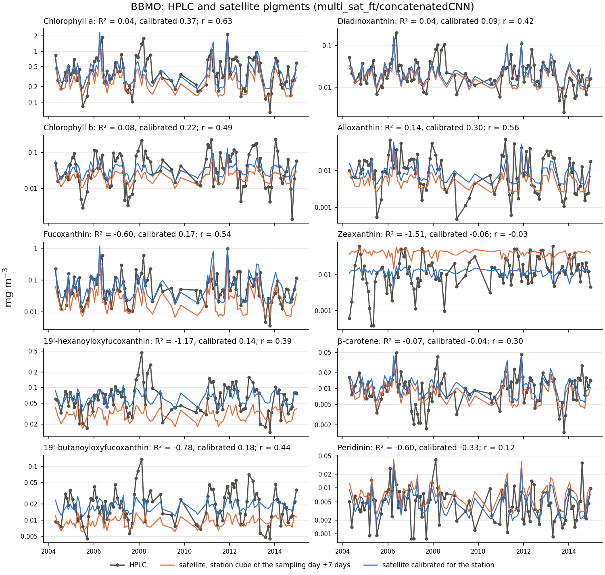
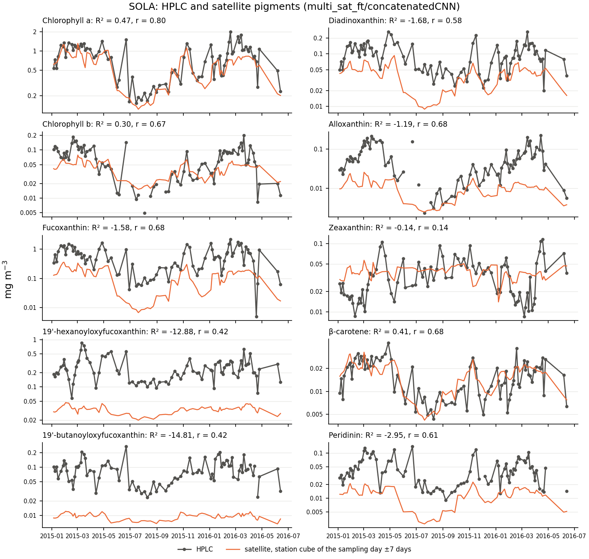

# Task 1 — From radiometry to pigments

A convolutional neural network estimates 13 phytoplankton pigments from remote sensing reflectance
(Rrs), at the 11 OLCI bands or at the 5 bands of the multi-sensor record.

- Code and trained models: [pigment-retrieval-from-olci](https://github.com/Kissyfur/pigment-retrieval-from-olci),
  installed with the environment (`requirements.txt`).
- Paper: Sánchez-López, B., Talone, M., Cerquides, J., Di Cicco, A., Martínez-Fornos, G. and Slavinec, P.
  (2026). Simultaneous retrieval of 13 phytoplankton pigments from Sentinel-3 OLCI using convolutional
  neural networks and transfer learning. *Frontiers in Remote Sensing*, 7.
  https://doi.org/10.3389/frsen.2026.1880618

This folder applies the model to the satellite record of two regions and four stations, and checks
it against the HPLC pigments of the Task 2 samples. Run everything from the repository root. The
data go to `task1/data/` and the figures to `task1/figures/`, neither kept in git.

| Area | Where | Satellite data |
|---|---|---|
| `nw_mediterranean` | 40.50–43.50 N, 1.50–5.50 E | monthly maps (step 1) |
| `balearic_islands` | 38.55–40.20 N, 1.10–4.50 E | monthly maps (step 1) |
| BBMO, SOLA, MOLA, VIDA | 5 × 5 pixels around each station | daily cubes (step 2) |

BBMO is the Blanes Bay Microbial Observatory, SOLA and MOLA the coastal and offshore stations of
Banyuls-sur-Mer, and VIDA the Vida buoy off Piran, in the Gulf of Trieste.

## 1. Monthly radiometry

Each month's mean of the daily 1 km multi-sensor Rrs of Copernicus Marine, from September 1997 to
today, floored at its 5% quantile and log-transformed:

```bash
python task1/scripts/download_monthly_means.py task1/configs/med_radiometry_monthly.yaml
```

This writes `task1/data/radiometry_monthly/<region>_monthly.nc`. The first run downloads about
39 GB (26 GB for the NW Mediterranean, 13 GB for the Balearic Islands). It resumes if interrupted,
and later runs only fetch the newest months.

## 2. Daily station cubes

A cube around each station for every day of the record (5 × 5 pixels of about 1 km, ±7 days),
built with [copernicus-matchup](https://github.com/Kissyfur/copernicus-matchup). Pixels without a
satellite retrieval stay empty; each band is floored at the 5% quantile of its positive values in
the cube, then log-transformed:

```bash
python task1/scripts/station_matchups.py task1/configs/station_matchups.yaml
```

This writes `task1/data/station_matchups/datasets/`. VIDA is at the Vida buoy (45.5488 N, 13.5505
E); the table of the Task 2 samples (ps_mtag.csv) rounds it to 45.5 N, 13.6 E, which is on land.

## 3. Pigments

The model for the 5 multi-sensor bands fine-tuned with satellite matchups
(`multi_sat_ft/concatenatedCNN`), on the monthly maps and on the station cubes:

```bash
python task1/scripts/predict_pigments.py
```

This writes the 13 pigments, in mg m⁻³, to `task1/data/pigments/`:
- `<region>_monthly.nc`, on the (time, latitude, longitude) grid of the monthly radiometry, with
  its `valid_days`. Means of one or two days can be unrealistic: filter on `valid_days`.
- `stations_daily.nc`, as (station, time, lat_pixel, lon_pixel): the pixels around each station,
  every day from 23 September 1997 to a week before the end of the record. Pixels without a
  satellite retrieval that day stay empty.

`--only monthly` or `--only stations` predicts one of the two. For other files, the environment
also has the `predict-pigments` command of Task 1.

## 4. Check against HPLC

The Task 2 samples (PETRIMED: SOLA, BBMO and MOLA, 196 in 2004–2021) have HPLC pigments. Each is
matched with its station cube of step 2: the 5 × 5 pixels around the station, from 7 days before
to 7 days after the sampling day. The convolutional Task 1 models of the multi-sensor bands predict
the pigments of every pixel and day with a satellite retrieval, and their median is compared with
the HPLC pigments, for the 10 pigments of the proposal:

```bash
python task1/scripts/hplc_check.py
```

The metrics are those of the Task 1 paper: the coefficient of determination R² of ln(pigment), and
the mean absolute percentage error (MAPE) and the bias (mean percentage error, MPE) of the
concentrations. The Pearson correlation r of ln(pigment) is added: unlike R², it ignores the bias,
so it shows whether the satellite pigments rise and fall with the HPLC ones.

Values below the detection limit are set to it before scoring, in the HPLC and the satellite
pigments alike. HPLC detects pigments down to about 0.0001 mg m⁻³ (chlorophyll a; Ras et al., 2008,
https://doi.org/10.5194/bg-5-353-2008), but the satellite pigments come from the satellite
reflectance and do not go that low, so the limit is set by the satellite: for each pigment, the 5%
quantile of the satellite pigments of the whole record around the four stations
(`task1/data/detection_limits.csv`), the same kind of floor that Task 1 applies to its reflectance
and to the pigments it was trained on. Below it the satellite cannot tell values apart, and the percentage
errors on such values are meaningless (a satellite 0.02 against an HPLC 0.001 mg m⁻³ is a +1900%
error). HPLC zeros, below detection too, now count at the limit instead of being left out. The limit
touches mostly zeaxanthin (91 of the 196 HPLC values are below it), peridinin (36), chlorophyll b
(30) and alloxanthin (28), and few satellite values (2–7 per pigment).

The script writes `task1/data/hplc_check.csv` and the figures below. For the model of the record
(`multi_sat_ft/concatenatedCNN`), on all 196 samples:

| Pigment | Detection limit (mg m⁻³) | R² | r | MAPE | Bias (MPE) |
|---|---|---|---|---|---|
| Chlorophyll a | 0.125 | 0.36 | 0.77 | 33% | −21% |
| Diadinoxanthin | 0.009 | 0.18 | 0.68 | 49% | −24% |
| Peridinin | 0.003 | 0.18 | 0.51 | 83% | +15% |
| Chlorophyll b | 0.012 | 0.17 | 0.59 | 50% | −13% |
| β-carotene | 0.004 | 0.14 | 0.56 | 41% | +3% |
| Alloxanthin | 0.003 | 0.00 | 0.74 | 57% | −41% |
| Fucoxanthin | 0.007 | −0.02 | 0.77 | 73% | −46% |
| Zeaxanthin | 0.018 | −0.89 | −0.02 | 85% | +70% |
| 19'-butanoyloxyfucoxanthin | 0.006 | −1.67 | 0.34 | 64% | −59% |
| 19'-hexanoyloxyfucoxanthin | 0.017 | −1.80 | 0.42 | 65% | −61% |

- The detection limit mostly removes percentage errors on values that the satellite cannot see:
  without it, the bias of zeaxanthin was +379% and of peridinin +52%, and the median MAPE 70%
  instead of 60%. It lowers R² a little (median over the 10 pigments 0.12 without it, 0.07 with
  it), since it narrows the range of the HPLC values, and leaves r unchanged.
- R² is at most 0.36, against 0.70–0.93 in situ and about 0.2 less on satellite data in the paper,
  mostly because of biases: the satellite pigments rise and fall with the HPLC ones (r = 0.59–0.77
  for chlorophylls a and b, fucoxanthin, alloxanthin and diadinoxanthin), but fucoxanthin and the
  haptophyte and pelagophyte pigments come out at about a third of the HPLC values (median ratio
  0.27–0.32), and zeaxanthin about 1.8 times higher. Zeaxanthin barely varies: it stays near
  0.04 mg m⁻³, and half of the HPLC values are below what the satellite gives.
- The underestimation is a coastal one and grows with concentration, as the satellite pigments vary
  less than the HPLC ones. Over time they follow the timing of the BBMO samples and the seasonal
  cycle of the weekly SOLA samples of 2015–2016, but not the size of their peaks. Fucoxanthin and
  the haptophyte and pelagophyte pigments come out at 13–21% of the HPLC values at SOLA, where the
  2015–2016 blooms give the highest values, and at 40–51% at BBMO. Offshore at MOLA (7 samples)
  most pigments are within about a third of HPLC.
- A bias by the same factor at all times would not change trends in % per decade or seasonal
  timing, the measures of Task 4. But the satellite pigments also vary less than the HPLC ones, so
  trends and seasonal amplitudes are damped, though their sign and timing hold, and the composition
  is distorted, which Task 2 corrects before using the pigments.
- The bias depends on the station, so the check also calibrates the model per station: each
  pigment times one factor, the median HPLC/satellite ratio of all the samples of the station.

  | Factor (HPLC / satellite) | Chl a | Chl b | Fuco | 19'-hex | 19'-but | Diadino | Allo | Zea | β-car | Peri |
  |---|---|---|---|---|---|---|---|---|---|---|
  | BBMO | 1.40 | 1.57 | 2.52 | 2.12 | 1.95 | 1.16 | 1.64 | 0.44 | 1.29 | 0.81 |
  | SOLA | 1.25 | 1.29 | 4.69 | 6.46 | 7.79 | 2.36 | 3.48 | 0.79 | 0.89 | 3.34 |
  | MOLA | 1.00 | 1.00 | 0.95 | 1.23 | 1.54 | 0.95 | 1.00 | 0.56 | 1.28 | 0.99 |

  Calibrated, the median R² over the 10 pigments goes from 0.07 to 0.57 on the 196 samples, and the
  median satellite/HPLC ratio of every pigment to about 1. The weak pigments gain most
  (fucoxanthin −0.02 → 0.65, 19'-hexanoyloxyfucoxanthin −1.80 → 0.65, 19'-butanoyloxyfucoxanthin
  −1.67 → 0.61, alloxanthin 0.00 → 0.56); zeaxanthin stays poor (0.09), and β-carotene and
  chlorophyll b gain little. These scores are on the samples the factors come from, so they are
  optimistic: with factors from the other years of each station only, the median R² is 0.54 at BBMO
  and SOLA together, 0.13 within BBMO and 0.26 within SOLA (part of the gain is removing the offset
  between stations). One factor corrects the level, not the range: the peaks stay flattened.
- The calibration is not applied to the satellite record, because the factors follow the water type
  more than the region: the coastal stations need fucoxanthin × 2.5 (BBMO) and × 4.7 (SOLA), the
  offshore MOLA almost nothing (× 0.95). One regional factor from all the samples, nearly all
  coastal, would improve the coastal stations a little (median R² at SOLA −1.11 → 0.09) but worsen
  MOLA (0.41 → 0.17, against 0.43 with its own factors), and the regional maps are mostly open sea.
  The factors (`task1/data/station_factors.csv`) give the absolute concentrations at the three
  stations, while a constant factor would not change the trends and seasonal timing of Task 4.
- Of the five CNNs, the one of the record, fine-tuned with satellite matchups, has the best median
  R² (0.07, against −0.33 to −0.11) and is the best for chlorophylls a and b and fucoxanthin. The
  others do better for 19'-hexanoyloxyfucoxanthin (r = 0.60–0.61 for three of them, against 0.42),
  diadinoxanthin and peridinin, and none for zeaxanthin.
- The window, 5 × 5 pixels (about 5 km) and the sampling day ±7 days, was the best of those tried
  (the tests are not kept, and were scored before the detection limit was set). With 11 × 9 pixels
  the median R² was 0.05 and the bias −24%, against 0.12 and −18%: the larger area adds offshore
  water, with less pigment than the coastal stations. 3 × 3 pixels reduce the bias a little more
  but lose 14 samples. The sampling day alone matches only 65 samples and agrees less with HPLC, as
  daily retrievals are noisy, and the global 4 km product with which the model was fine-tuned
  overestimates chlorophyll a by about 60% next to the coast.

<p align="center">
  
</p>

*`multi_sat_ft/concatenatedCNN` on the station cubes (sampling day ±7 days) against HPLC, all
samples; dotted, the detection limit, to which the values below it are set.*

<p align="center">
  
</p>

*HPLC and satellite pigments at BBMO, 2004–2014, as retrieved and calibrated for the station; R² and
r of this station; dotted, the detection limit.*

<p align="center">
  
</p>

*HPLC and satellite pigments at SOLA, 2015–2016, as retrieved and calibrated for the station; R² and
r of this station; dotted, the detection limit.*
