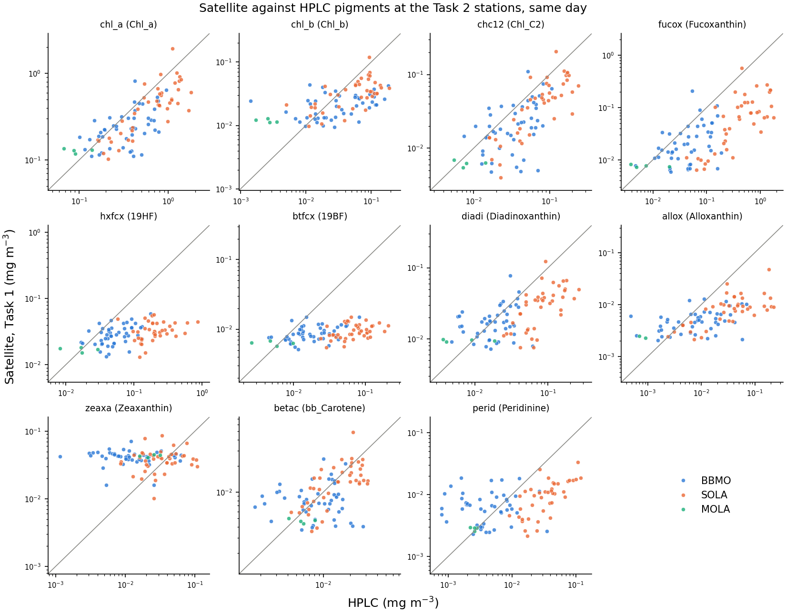
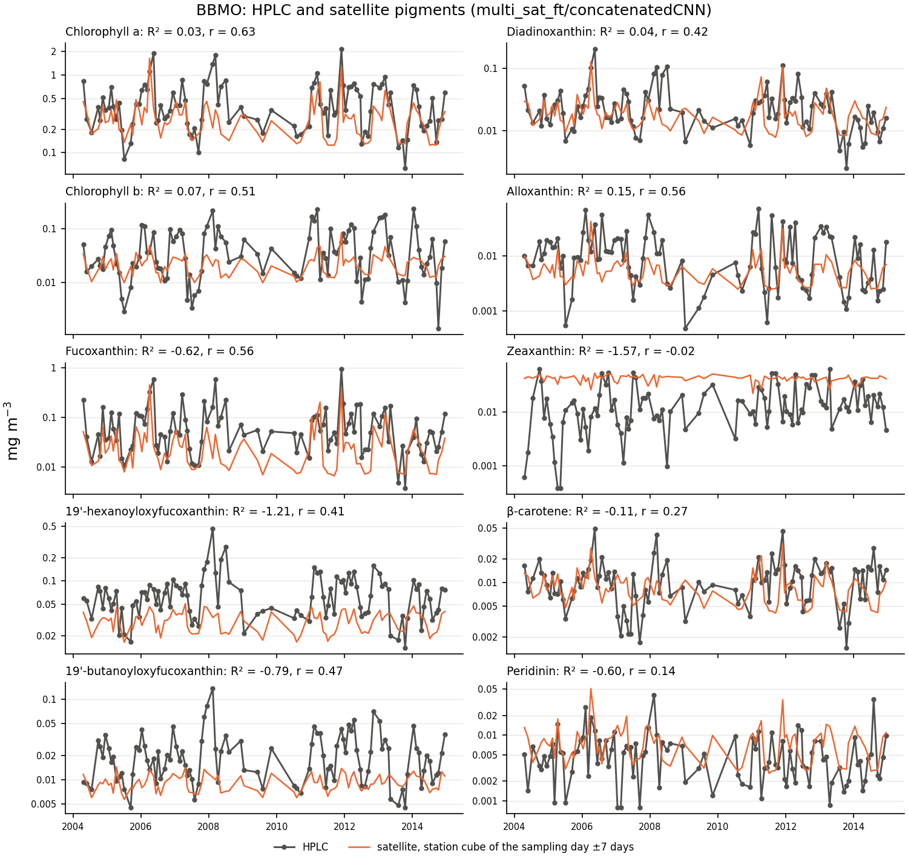
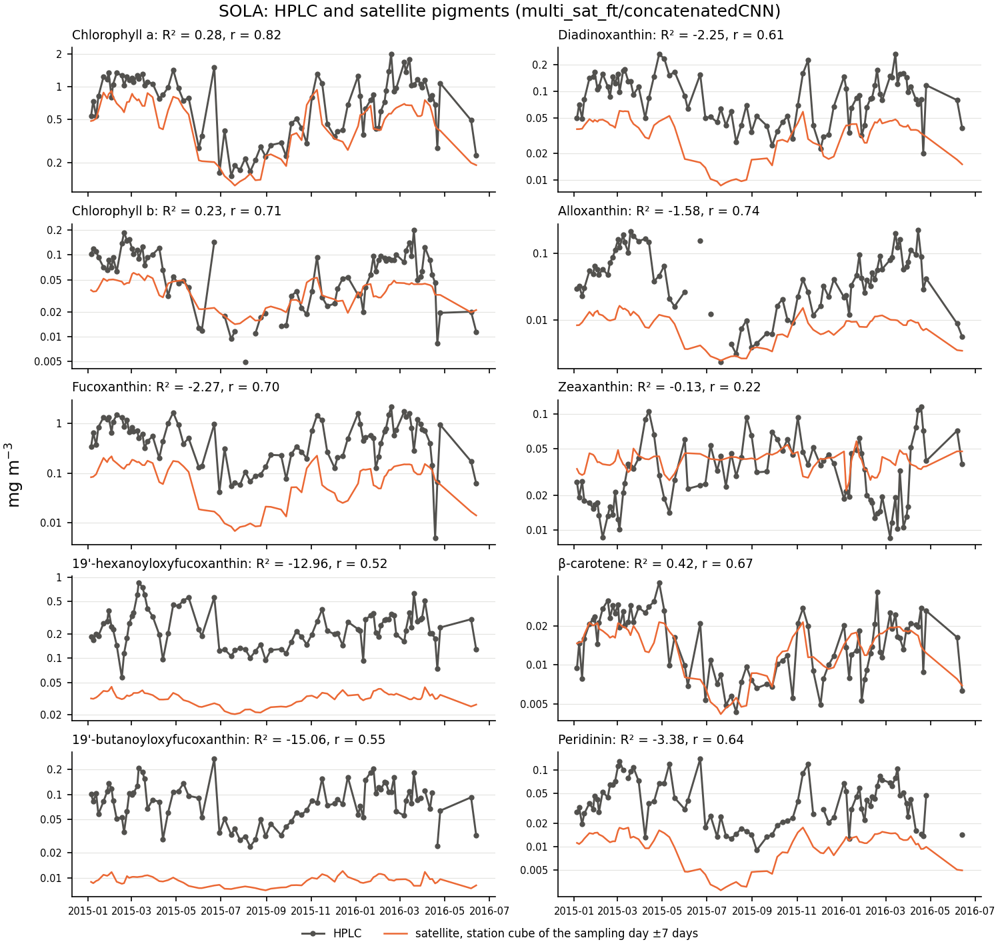

# Task 1 — From radiometry to pigments

A convolutional neural network estimates 13 phytoplankton pigments from remote sensing reflectance
(Rrs), at the 11 OLCI bands or at the 5 bands of the multi-sensor record.

- Code and trained models: [pigment-retrieval-from-olci](https://github.com/Kissyfur/pigment-retrieval-from-olci),
  installed with the environment (`requirements.txt`).
- Paper: Sánchez-López, B., Talone, M., Cerquides, J., Di Cicco, A., Martínez-Fornos, G. and Slavinec, P.
  (2026). Simultaneous retrieval of 13 phytoplankton pigments from Sentinel-3 OLCI using convolutional
  neural networks and transfer learning. *Frontiers in Remote Sensing*, 7.
  https://doi.org/10.3389/frsen.2026.1880618

This folder applies the model to the satellite record of two regions and four stations, and checks
it against the HPLC pigments of the Task 2 samples. Run everything from the repository root. The
data go to `task1/data/` and the figures to `task1/figures/`, neither kept in git.

| Area | Where | Satellite data |
|---|---|---|
| `nw_mediterranean` | 40.50–43.50 N, 1.50–5.50 E | monthly maps (step 1) |
| `balearic_islands` | 38.55–40.20 N, 1.10–4.50 E | monthly maps (step 1) |
| BBMO, SOLA, MOLA, VIDA | 11 × 9 pixels around each station | daily cubes (step 2) |

BBMO is the Blanes Bay Microbial Observatory, SOLA and MOLA the coastal and offshore stations of
Banyuls-sur-Mer, and VIDA the Vida buoy off Piran, in the Gulf of Trieste.

## 1. Monthly radiometry

Each month's mean of the daily 1 km multi-sensor Rrs of Copernicus Marine, from September 1997 to
today, floored at its 5% quantile and log-transformed:

```bash
python task1/scripts/download_monthly_means.py task1/configs/med_radiometry_monthly.yaml
```

This writes `task1/data/radiometry_monthly/<region>_monthly.nc`. The first run downloads about
39 GB (26 GB for the NW Mediterranean, 13 GB for the Balearic Islands). It resumes if interrupted,
and later runs only fetch the newest months.

## 2. Daily station cubes

A cube around each station for every day of the record (11 × 9 pixels of about 1 km, ±7 days),
built with [copernicus-matchup](https://github.com/Kissyfur/copernicus-matchup). Pixels without a
satellite retrieval stay empty; each band is floored at the 5% quantile of its positive values in
the cube, then log-transformed:

```bash
python task1/scripts/station_matchups.py task1/configs/station_matchups.yaml
```

This writes `task1/data/station_matchups/datasets/`. VIDA is at the Vida buoy (45.5488 N, 13.5505
E); the table of the Task 2 samples (ps_mtag.csv) rounds it to 45.5 N, 13.6 E, which is on land.

## 3. Pigments

The model for the 5 multi-sensor bands fine-tuned with satellite matchups
(`multi_sat_ft/concatenatedCNN`), on the monthly maps and on the station cubes:

```bash
python task1/scripts/predict_pigments.py
```

This writes the 13 pigments, in mg m⁻³, to `task1/data/pigments/`:
- `<region>_monthly.nc`, on the (time, latitude, longitude) grid of the monthly radiometry, with
  its `valid_days`. Means of one or two days can be unrealistic: filter on `valid_days`.
- `stations_daily.nc`, as (station, time, lat_pixel, lon_pixel): the pixels around each station,
  every day from 23 September 1997 to a week before the end of the record. Pixels without a
  satellite retrieval that day stay empty.

`--only monthly` or `--only stations` predicts one of the two. For other files, the environment
also has the `predict-pigments` command of Task 1.

## 4. Check against HPLC

The Task 2 samples (PETRIMED: SOLA, BBMO and MOLA, 196 in 2004–2021) have HPLC pigments. Each is
matched with its station cube of step 2: the 11 × 9 pixels around the station, from 7 days before
to 7 days after the sampling day. The convolutional Task 1 models of the multi-sensor bands predict
the pigments of every pixel and day with a satellite retrieval, and their median is compared with
the HPLC pigments, for the 10 pigments of the proposal:

```bash
python task1/scripts/hplc_check.py
```

The metrics are those of the Task 1 paper: the coefficient of determination R² of ln(pigment), and
the mean absolute percentage error (MAPE) and the bias (mean percentage error, MPE) of the
concentrations. The Pearson correlation r of ln(pigment) is added: unlike R², it ignores the bias,
so it shows whether the satellite pigments rise and fall with the HPLC ones. The script writes
`task1/data/hplc_check.csv` and the figures below. For the model of the record
(`multi_sat_ft/concatenatedCNN`), on all 196 samples:

| Pigment | R² | r | MAPE | Bias (MPE) |
|---|---|---|---|---|
| Chlorophyll a | 0.33 | 0.78 | 37% | −25% |
| Chlorophyll b | 0.24 | 0.62 | 73% | +4% |
| β-carotene | 0.17 | 0.52 | 47% | +4% |
| Diadinoxanthin | 0.14 | 0.66 | 56% | −23% |
| Peridinin | 0.14 | 0.46 | 122% | +49% |
| Alloxanthin | −0.05 | 0.71 | 75% | −29% |
| Fucoxanthin | −0.16 | 0.76 | 75% | −51% |
| Zeaxanthin | −0.72 | −0.04 | 402% | +390% |
| 19'-butanoyloxyfucoxanthin | −1.67 | 0.37 | 66% | −59% |
| 19'-hexanoyloxyfucoxanthin | −1.75 | 0.45 | 66% | −61% |

- R² is at most 0.33, against 0.70–0.93 in situ and about 0.2 less on satellite data in the paper,
  mostly because of biases: the satellite pigments rise and fall with the HPLC ones (r = 0.62–0.78
  for chlorophylls a and b, fucoxanthin, alloxanthin and diadinoxanthin), but fucoxanthin and the
  haptophyte and pelagophyte pigments come out at half the HPLC values or less, and zeaxanthin
  about five times higher. Zeaxanthin barely varies: it stays near 0.04 mg m⁻³.
- Over time, the satellite pigments follow the timing of the BBMO samples and the seasonal cycle of
  the weekly SOLA samples of 2015–2016, but not the size of their peaks: in the SOLA blooms,
  fucoxanthin, the haptophyte and pelagophyte pigments, alloxanthin and peridinin stay several
  times below the HPLC values.
- Of the five CNNs, the one of the record, fine-tuned with satellite matchups, has the best median
  R² (0.05, against −0.28 to −0.09) and is the best for chlorophylls a and b and fucoxanthin. The
  others do better for 19'-hexanoyloxyfucoxanthin (r = 0.64–0.65 for three of them, against 0.45)
  and peridinin, and none for zeaxanthin.
- The window, sampling day ±7 days, was the best of those tried (the tests are not kept). The
  sampling day alone matches only 92 samples, and agrees less with HPLC: daily retrievals are noisy.
  Larger areas, up to about 30 km, add offshore water, with less chlorophyll than the stations. The
  3 × 3 pixels and ±1 day of the global 4 km product with which the model was fine-tuned
  overestimate chlorophyll a by about 60% next to the coast.

<p align="center">
  
</p>

*`multi_sat_ft/concatenatedCNN` on the station cubes (sampling day ±7 days) against HPLC, all samples.*

<p align="center">
  
</p>

*HPLC and satellite pigments at BBMO, 2004–2014; R² and r of this station.*

<p align="center">
  
</p>

*HPLC and satellite pigments at SOLA, 2015–2016; R² and r of this station.*
