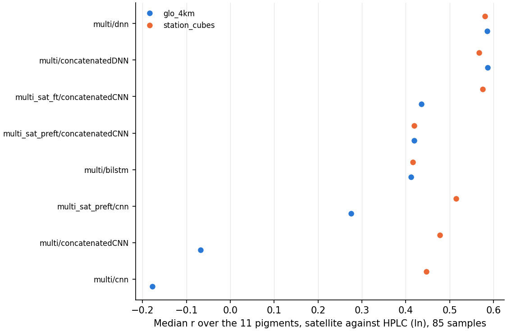

# Task 1 — From radiometry to pigments

A convolutional neural network estimates 13 phytoplankton pigments from remote sensing reflectance
(Rrs), at the 11 OLCI bands or at the 5 bands of the multi-sensor record.

- Code and trained models: [pigment-retrieval-from-olci](https://github.com/Kissyfur/pigment-retrieval-from-olci),
  installed with the environment (`requirements.txt`).
- Paper: Sánchez-López, B., Talone, M., Cerquides, J., Di Cicco, A., Martínez-Fornos, G. and Slavinec, P.
  (2026). Simultaneous retrieval of 13 phytoplankton pigments from Sentinel-3 OLCI using convolutional
  neural networks and transfer learning. *Frontiers in Remote Sensing*, 7.
  https://doi.org/10.3389/frsen.2026.1880618

This folder applies the model to the satellite record of the two study regions, and checks it
against the HPLC pigments of the Task 2 samples. Run everything from the repository root. The data
go to `task1/data/` and the figures to `task1/figures/`, neither kept in git.

| Region | Box | Stations |
|---|---|---|
| `north_adriatic` | 44.50–45.85 N, 12.20–14.50 E | VIDA (Vida buoy, Piran) |
| `nw_mediterranean` | 40.50–43.50 N, 1.50–5.50 E | BBMO (Blanes), SOLA and MOLA (Banyuls-sur-Mer) |

## 1. Monthly radiometry

Each month's mean of the daily 1 km multi-sensor Rrs of Copernicus Marine, from September 1997 to
today, floored at its 5% quantile and log-transformed:

```bash
python task1/scripts/download_monthly_means.py task1/configs/med_radiometry_monthly.yaml
```

This writes `task1/data/radiometry_monthly/<region>_monthly.nc`. The first run downloads about
33 GB. It resumes if interrupted, and later runs only fetch the newest months.

## 2. Daily station cubes

A cube around each station for every day of the record (11 × 9 pixels of about 1 km, ±7 days),
built with [copernicus-matchup](https://github.com/Kissyfur/copernicus-matchup):

```bash
python task1/scripts/station_matchups.py task1/configs/station_matchups.yaml
```

This writes `task1/data/station_matchups/datasets/`. VIDA is at the Vida buoy (45.5488 N, 13.5505
E); the table of the Task 2 samples (ps_mtag.csv) rounds it to 45.5 N, 13.6 E, which is on land.

## 3. Pigments

The model for the 5 multi-sensor bands fine-tuned with satellite matchups
(`multi_sat_ft/concatenatedCNN`), on the monthly maps and on the station cubes:

```bash
python task1/scripts/predict_pigments.py
```

This writes the 13 pigments, in mg m⁻³, to `task1/data/pigments/`:
- `<region>_monthly.nc`, on the (time, latitude, longitude) grid of the monthly radiometry, with
  its `valid_days`. Means of one or two days can be unrealistic: filter on `valid_days`.
- `stations_daily.nc`, as (station, time, lat_pixel, lon_pixel): the pixels around each station,
  every day from 30 September 1997 to two weeks before the end of the record. Only the pixels with
  a satellite retrieval that day are predicted, not the gaps that the cubes fill by interpolation.

`--only monthly` or `--only stations` predicts one of the two. For other files, the environment
also has the `predict-pigments` command of Task 1.

## 4. Check against HPLC

The Task 2 samples (PETRIMED: SOLA, BBMO and MOLA, 196 in 2004–2021) have HPLC pigments. The check
matches them with satellite Rrs in three ways, predicts their pigments with the 8 Task 1 models of
the multi-sensor bands, and compares them with the HPLC ones with the metrics of Task 1 on
ln(pigment):

```bash
python task1/scripts/hplc_matchups.py task1/configs/hplc_matchups.yaml
```

- `station_cubes`: the cubes of step 2 on the sampling day (Mediterranean 1 km product, 11 × 9
  pixels, the median of the pixel predictions), the way the Task 4 record is made. 92 samples.
- `glo_4km`: as the Task 1 satellite matchups were built: global 4 km product, 3 × 3 pixels, ±1
  day, kept when more than 20% of the cube has data, averaged with weights that decrease from the
  centre. 148 samples.
- `med_1km`: the same 3 × 3 pixels and ±1 day on the Mediterranean 1 km product. Next to the coast
  most of these pixels are land or flagged: 22 samples only.

It writes `task1/data/hplc_matchups/scores.csv` and the two figures below. For the model and matchup
of the record (`multi_sat_ft/concatenatedCNN` on the station cubes):

| Pigment | r (ln) | MAPE | Bias (MPE) |
|---|---|---|---|
| Chlorophyll a | 0.76 | 39% | −22% |
| Chlorophyll c (HPLC: c2 only) | 0.74 | 48% | −32% |
| Fucoxanthin | 0.72 | 70% | −53% |
| Alloxanthin | 0.66 | 83% | −18% |
| Diadinoxanthin | 0.60 | 59% | −16% |
| Chlorophyll b | 0.58 | 92% | +21% |
| 19'-hexanoyloxyfucoxanthin | 0.45 | 62% | −56% |
| β-carotene | 0.45 | 54% | +13% |
| 19'-butanoyloxyfucoxanthin | 0.44 | 65% | −57% |
| Peridinin | 0.42 | 130% | +55% |
| Zeaxanthin | −0.04 | 259% | +243% |

Median r over the 11 pigments on the 85 samples that both main matchups have:

| Model | Trained with | Station cubes | Global 4 km |
|---|---|---|---|
| `multi/dnn` | in situ data | 0.58 | 0.58 |
| `multi/concatenatedDNN` | in situ data | 0.57 | 0.59 |
| `multi_sat_ft/concatenatedCNN` | in situ, then satellite matchups | 0.57 | 0.44 |
| `multi_sat_preft/cnn` | in situ and satellite matchups | 0.52 | 0.28 |
| `multi/concatenatedCNN` | in situ data | 0.48 | −0.07 |
| `multi/cnn` | in situ data | 0.45 | −0.18 |
| `multi/bilstm` | in situ data | 0.42 | 0.41 |
| `multi_sat_preft/concatenatedCNN` | in situ and satellite matchups | 0.42 | 0.42 |

- The satellite pigments follow the HPLC ones for chlorophylls a and c, fucoxanthin, alloxanthin and
  diadinoxanthin, but miss the highest values (the SOLA samples of 2015–2016). The haptophyte and
  pelagophyte pigments barely vary, and zeaxanthin not at all: it stays near 0.04 mg m⁻³, 3.4 times
  the HPLC values on average. No model or matchup retrieves zeaxanthin (r ≤ 0.16).
- The matchup is not what limits the record: the station cubes do as well as the matchups the model
  was fine-tuned with, and better for that model (0.57 against 0.44 on the global 4 km product).
  The peaks are missed on the sampling day too, so it is not the monthly averaging either. Part of
  the gap is the scale: a point sample against kilometres of a coastal station.
- The dense networks trained only with in situ data adapt to satellite data as well as the
  fine-tuned CNN, and better for the haptophyte and pelagophyte pigments (on the station cubes,
  `multi/dnn` reaches r = 0.60 for 19'-hexanoyloxy- and 0.66 for 19'-butanoyloxyfucoxanthin,
  against 0.47 and 0.42), but come out lower for chlorophyll a (0.71 against 0.77). The CNNs
  trained only with in situ data do not adapt: on the global product their values are several to
  tens of times the HPLC ones.

<p align="center">
  
</p>

*`multi_sat_ft/concatenatedCNN` on the station cubes against HPLC, same day.*

<p align="center">
  
</p>

*Median r over the 11 pigments per model and matchup, on the 85 shared samples.*
