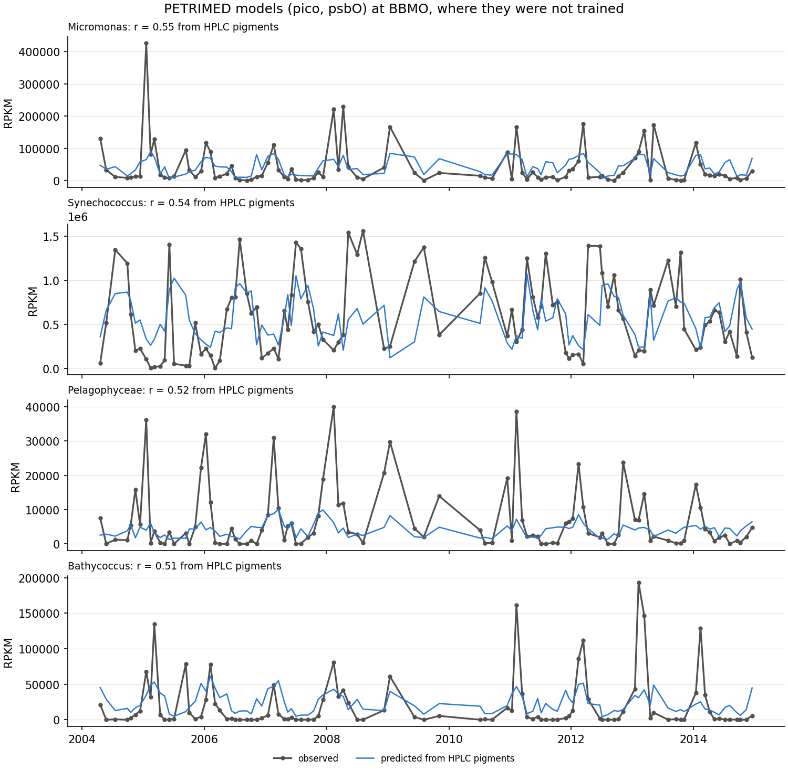
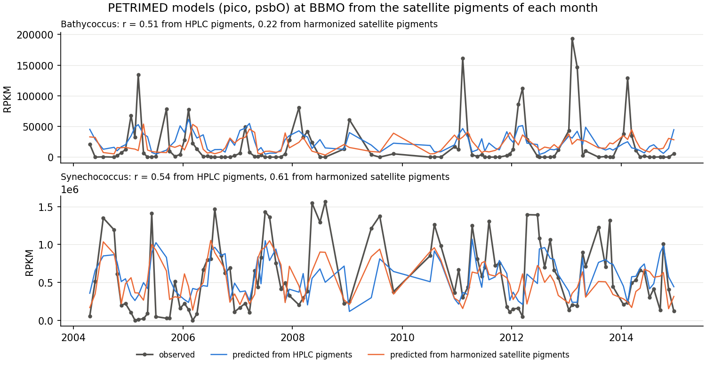

# Task 2 — From pigments to plankton diversity

> **Provisional.** PETRIMED predicts the abundance of plankton groups and taxa; the biodiversity
> indicator built from them is still to come, and this task will be rewritten with it.

The models come from [PETRIMED](https://github.com/pjmramond/PETRIMED), the code of Ramond et al. (in
preparation), *Inferring plankton biodiversity combining meta-omics and pigment data: a bridge
towards satellite monitoring*. They are XGBoost models trained at SOLA in 2015–2016 that predict
the abundance of plankton sequence types (PSTs) in the pico (0.2–3 µm) and nano (3–20 µm)
fractions from the relative composition of 12 HPLC pigments, with the PSTs measured three ways:
psbO gene, metagenome-assembled genomes and metabarcoding. Here the pico psbO models are used,
those that transfer best.

Run everything from the repository root. `task2/PETRIMED`, `task2/data/` and `task2/figures/` are
not kept in git.

## 1. The PETRIMED models and their transfer

```bash
git clone --depth 1 https://github.com/pjmramond/PETRIMED.git task2/PETRIMED   # used at commit 8c442cf
Rscript task2/scripts/export_models.R
python task2/scripts/psts.py
```

- `task2/PETRIMED` is a local copy: changes to it stay local.
- `export_models.R` exports to `task2/data/models` the models that PETRIMED averages, those with a
  validation correlation of at least 0.6, as xgboost JSON for Python. It needs R with the xgboost
  package (`install.packages("xgboost")`): the models were saved with xgboost 2 or later.
- `psts.py` predicts as PETRIMED does (pigments relative to their total, mean of the models), with
  the same results as in R, and tests the models on the HPLC pigments of BBMO (100 samples,
  2004–2014) and MOLA (7, 2020–2021), where they were not trained. It writes
  `task2/data/transferability.csv` and `task2/figures/insitu_check.png`.

Correlation between predicted and observed abundance, for the psbO PSTs best predicted at BBMO:

| PST (pico, psbO) | Models | Validation at SOLA | BBMO | BBMO, prasinoxanthin from chlorophyll b | MOLA (7 samples) |
|---|---|---|---|---|---|
| Micromonas | 428 | 0.72 | 0.55 | 0.57 | −0.13 |
| Synechococcus | 594 | 0.75 | 0.54 | 0.52 | 0.89 |
| Pelagophyceae | 251 | 0.67 | 0.52 | 0.52 | 0.51 |
| Bathycoccus | 192 | 0.69 | 0.51 | 0.50 | 0.88 |
| Prochlorococcus | 194 | 0.68 | 0.48 | 0.49 | −0.39 |

- Validation at SOLA is the mean correlation of the averaged models on PETRIMED's validation
  samples; it is optimistic, since the models were kept for scoring at least 0.6 on them. Away
  from SOLA, 4 of the 18 psbO PSTs keep r ≥ 0.5 at BBMO.
- The models follow the timing of these PSTs at BBMO but miss the size of their peaks.
- Prasinoxanthin, which Task 1 does not estimate, can be replaced by 0.30 × chlorophyll b, their
  ratio at SOLA: r changes by 0.06 at most.

<p align="center">
  
</p>

*The four psbO PSTs that transfer best, at BBMO: observed, and predicted from the HPLC pigments.*

## 2. On the satellite pigments of Task 1

```bash
python task2/scripts/predict_psts.py
```

It needs the pigments of Task 1 (`task1/data/pigments/`). Their composition lies outside what the
models learned: zeaxanthin is 10% of the satellite pigments around BBMO, against 1–2% in the HPLC
samples. The script first maps each pigment share, by quantiles, onto its HPLC distribution at SOLA
and MOLA (harmonization). It then checks the models at BBMO, which the harmonization does not use,
from the satellite pigments of the month of each sample:

| PST (pico, psbO) | From HPLC pigments | From satellite pigments | Harmonized | Harmonized, seasonal cycle |
|---|---|---|---|---|
| Micromonas | 0.55 | −0.24 | −0.10 | 0.05 |
| Synechococcus | 0.54 | 0.02 | **0.61** | **0.88** |
| Pelagophyceae | 0.52 | −0.21 | −0.15 | −0.28 |
| Bathycoccus | 0.51 | 0.18 | 0.22 | **0.54** |

- From the satellite pigments as they are, no PST holds and the seasonal cycles come out inverted.
  Harmonized, Synechococcus holds, and so does the seasonal cycle of Bathycoccus; no other PST
  does. The harmonization was chosen after seeing the failure: it is a hypothesis that this check
  supports, not a validated method.
- The satellite zeaxanthin barely varies (Task 1, step 4), so its share is almost the inverse of
  chlorophyll a: the Synechococcus indicator is mostly a low-chlorophyll signal, which the observed
  Synechococcus also follows at BBMO.
- Both the models and the harmonization come from the NW Mediterranean. As planned in the proposal
  (Risk 3), the plankton groups are analysed there; the VIDA data of Task 3 will tell whether they
  hold in the Gulf of Trieste.

The script then predicts these two PSTs and writes to `task2/data/psts/`, in about 10 minutes:
- `satellite_check.csv`, `pigment_quantiles.csv` and `task2/figures/satellite_check.png`: the check
  (`--check-only` stops there);
- `<region>_monthly.nc`: their abundance (psbO RPKM) on the grid of the monthly pigments, with their
  `valid_days`;
- `stations_monthly.nc`: the same from the median of each month of the pigments around each
  station, as checked at BBMO.

<p align="center">
  
</p>

*Synechococcus and Bathycoccus at BBMO: observed, and predicted from the HPLC pigments and from the
harmonized satellite pigments of each month.*
