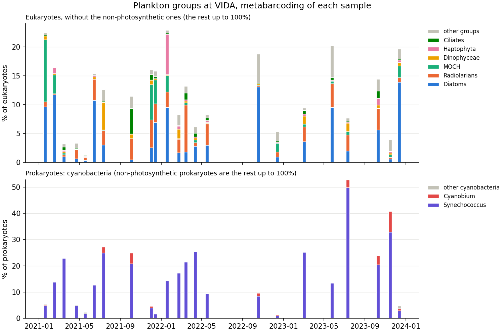
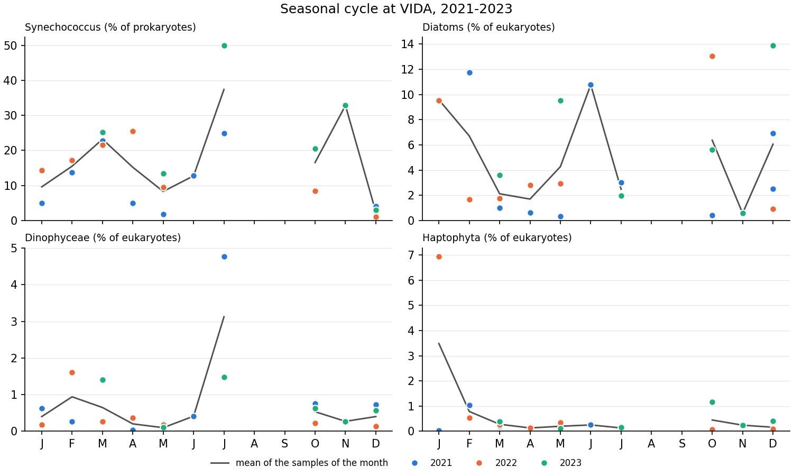

# Task 3 — Plankton groups at VIDA

A metabarcoding time series of the plankton at the Vida buoy, off Piran in the Gulf of Trieste
(45.549 N, 13.551 E), from January 2021 to December 2023. The sequences are summarized into the
plankton groups (plankton sequence types, PSTs) of PETRIMED ([Task 2](../task2/README.md)), so that
the groups predicted from satellite data can be compared with those observed in the Gulf of
Trieste.

## 1. The data

`task3/VIDA_PST.xlsx`: one sheet, one row per sample, 23 samples.

| Column | Content |
|---|---|
| `ID_Prokaryota`, `ID_Eukaryota` | Codes of the sample in the prokaryote and eukaryote sequencing |
| `Date` | Sampling day |
| `Depth`, `Lat`, `Long`, `ST` | 1 m, 45.54875 N, 13.5507 E, VIDA |
| `SF` | Size fraction: > 0.8 µm |
| 21 eukaryote groups, `Non.Photosynthetic.Eukaryotes` to `Eustigmatophyceae` | Relative abundance, % of the eukaryotes (100% per sample) |
| 5 prokaryote groups, `Non.Photosynthetic.Prokaryotes` to `Cyanobium` | Relative abundance, % of the prokaryotes (100% per sample) |

Samples were taken about once a month, never in August or September:

| Year | Months sampled |
|---|---|
| 2021 | January to July, October, December (twice) |
| 2022 | January to May, October, December |
| 2023 | March, May, July, October, November, December |

- The groups are those of PETRIMED's metabarcoding table at SOLA, with some differences. VIDA has
  no Bathycoccus, Micromonas or Chlorodendrales, and its other green algae (`Other.Chlorophyta`)
  are zero in every sample. It adds radiolarians (`Acantharea`, `Polycystinea`), `Chlorarachnida`,
  `Pinguiophyceae`, `Eustigmatophyceae` (always zero), `Cyanobium` and an `Unknown` group.
- The size fraction is > 0.8 µm, against the pico (0.2–3 µm) and nano (3–20 µm) fractions at SOLA:
  a difference foreseen in the proposal (Risk 2).
- The sample of 3 March 2023 has the eukaryote code `Feb23.0`; the analysis uses `Date`.

## 2. Description

```bash
python task3/scripts/describe_vida.py
```

It prints the sampling dates and the mean and maximum of each group, and draws the two figures
below into `task3/report/`. Diatoms are the sum of `Mediophyceae`, `Bacillariophyceae` and
`Coscinodiscophyceae`, and radiolarians that of `Acantharea` and `Polycystinea`.

| Group | Mean | Range | Maximum |
|---|---|---|---|
| *% of the eukaryotes* | | | |
| Non-photosynthetic eukaryotes | 88% | 77–99% | May 2021 |
| Diatoms (mostly Mediophyceae) | 5.0% | 0.3–13.9% | December 2023 |
| Radiolarians | 2.4% | 0.2–8.1% | March 2022 |
| MOCH (marine ochrophytes) | 1.5% | 0–10.8% | January 2021 |
| Dinophyceae | 0.7% | 0–4.8% | July 2021 |
| Haptophyta | 0.6% | 0–6.9% | January 2022 |
| Ciliates | 0.6% | 0–4.4% | October 2021 |
| *% of the prokaryotes* | | | |
| Non-photosynthetic prokaryotes | 83% | 47–98.5% | December 2022 |
| Synechococcus | 15.4% | 1.1–49.9% | July 2023 |
| Cyanobium | 1.1% | 0–7.9% | November 2023 |

The other groups are below 0.4% on average, and Prochlorococcus below 0.1%.

- **Synechococcus** is lowest in December (1–4% of the prokaryotes every year) and highest in
  July (25% in 2021, 50% in 2023) and October–November (8–33%), with high values in March too
  (21–25%). Cyanobium is above 1% only from July to November.
- **Diatoms** are the main photosynthetic eukaryotes, without a regular season: above 9% of the
  eukaryotes in January 2021 and 2022, February and June 2021, October 2022, and May and December
  2023, and below 4% in every March and April.
- Other groups have single peaks: MOCH in winter (January 2021, December 2021), haptophytes in
  January 2022, dinoflagellates in July 2021 and Dictyochophyceae in May 2023 (5.1%).
- The satellite predictions of [Task 4](../task4/README.md) put the maximum of Synechococcus at
  VIDA in May, when its observed share (2–14%) is below that of March, July and autumn: as
  suspected there, the models of Task 2, made in the NW Mediterranean, do not follow Synechococcus
  in the Gulf of Trieste.

<p align="center">
  
</p>

*The groups of each sample: eukaryotes without the non-photosynthetic ones (top) and cyanobacteria
(bottom); the rest up to 100% is non-photosynthetic.*

<p align="center">
  
</p>

*Seasonal cycle of Synechococcus, diatoms, dinoflagellates and haptophytes: each sample, coloured by
year, and the mean of each month.*
