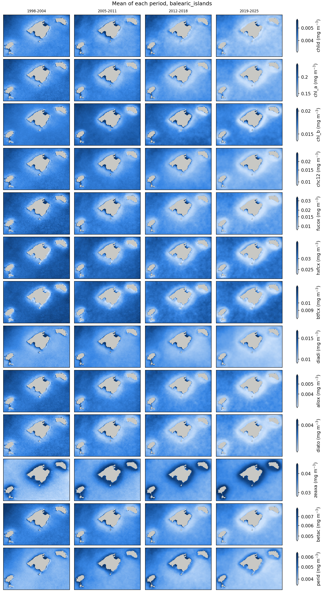

# Task 4 — 25 years of satellite records

*Technical note, draft. The part on plankton groups (section 2.6) will be rewritten with the
biodiversity indicator of Task 2.*

## Summary

The pigments that Task 1 retrieves from the 1 km multi-sensor record (1997–2026) are analysed over
two regions, the NW Mediterranean (Catalan coast and Gulf of Lion) and the Balearic Islands, and
around four stations: BBMO, SOLA and MOLA on the Catalan and French coast, and VIDA in the Gulf of
Trieste. They carry essentially two independent signals: biomass, and one axis of composition. They
reproduce the contrast between the coast (diatom pigments) and the open sea (haptophyte, pelagophyte
and cyanobacterial pigments), the late-winter bloom of the Catalan coast, a winter maximum around the
Balearic Islands two months earlier, and an autumn maximum at VIDA. From 2003 to 2025 the NW
Mediterranean loses chlorophyll a (−8% per decade) and fucoxanthin (−18%) while zeaxanthin rises
(+5%), as satellite functional types do over the Mediterranean (Martínez-Fornos et al., 2026); the
Balearic Islands change the same way, more weakly, and VIDA has no trend. Of the plankton groups of
Task 2, only Synechococcus can be followed from these pigments, and mostly as a low-chlorophyll
signal. A step in the record around 2002–2003 (change of sensors), the floor of the model near
0.1 mg m⁻³ of chlorophyll a, which the Balearic summer reaches, and the poor retrieval of zeaxanthin
limit the trends and the composition signal.

## 1. Data and methods

- **Areas**: two regions of monthly maps, the NW Mediterranean (40.5–43.5 N, 1.5–5.5 E) and the
  Balearic Islands (38.55–40.2 N, 1.1–4.5 E); and four stations, each with the 11 × 9 pixels (about
  11 × 10 km) around it: BBMO (Blanes Bay), SOLA and MOLA (Banyuls-sur-Mer, coastal and offshore)
  and VIDA (Vida buoy, Gulf of Trieste).
- **Pigments**: the 13 pigments of the Task 1 model fine-tuned with satellite matchups, on the
  monthly means of the daily 1 km multi-sensor Rrs and on the daily cubes of the stations
  ([Task 1](../task1/README.md)), checked against HPLC samples at the stations.
- **Plankton groups**: Synechococcus and Bathycoccus (pico, psbO), the PETRIMED models (Ramond et
  al., 2026) that hold from the satellite pigments once harmonized ([Task 2](../task2/README.md)).
- **Statistics**: months averaged from fewer than 3 days are left out; a region's value is the
  median of its pixels, a station's the median of its pixels and days; trends are log-linear fits
  of the annual values from 2003 to 2025 (see 3 for why 2003); the principal components are those
  of the ln pigments of the monthly maps.
- **Figures**: `python task4/scripts/figures.py` writes to `task4/figures/pigments/` and
  `task4/figures/psts/`, for every pigment or plankton group: the mean of each complete year
  (`<region>/<variable>_years.png`), the means of four periods of about seven years
  (`<region>/periods.png`) and the monthly series around each station (`stations/<station>.png`).
  The figures below are copies of some of them, in `task4/report/`.

## 2. Results

**2.1. The 13 pigments carry two signals.** In both regions, one principal component of the
monthly maps, with all pigments rising and falling with chlorophyll a, explains most of the
variance: 81% in the NW Mediterranean and 85% around the Balearic Islands. A second one, mostly
zeaxanthin against 19'-butanoyloxyfucoxanthin (and, in the NW Mediterranean, 19'-hexanoyloxy-
fucoxanthin), explains 14% and 8%, and the other eleven 4–7%. This is about all that multispectral
ocean colour can give: satellite reflectances hold about two independent quantities, and the
products derived from them one (Cael et al., 2023), and in situ most diagnostic pigments follow
chlorophyll a too (Hirata et al., 2011). Diversity indicators computed from these pigments will
mostly re-express chlorophyll a plus one axis of composition, a caution that Martínez-Fornos et al.
(2026) also make for their satellite Shannon index.

**2.2. Diatoms on the coast, haptophytes and cyanobacteria offshore.** In the NW Mediterranean the
share of fucoxanthin in chlorophyll a is 2.2 times higher in the most productive waters (top 10% of
chlorophyll a) than in the least productive ones, where the shares of 19'-hexanoyloxyfucoxanthin
(2.4 times), 19'-butanoyloxyfucoxanthin (2.8 times) and zeaxanthin (2.3 times) are higher, and the
haptophyte and pelagophyte pigments hardly follow chlorophyll a (r = 0.18 and −0.09). The waters
around the Balearic Islands are oligotrophic throughout (80% of the pixels between 0.16 and
0.20 mg m⁻³ of chlorophyll a, on average), and 19'-hexanoyloxyfucoxanthin and zeaxanthin are the
main pigments after chlorophyll a everywhere, with fucoxanthin half of what it is in the productive
NW Mediterranean. This matches the in situ picture: diatoms make the blooms (Nunes et al., 2018),
haptophytes and prokaryotes are the main groups of the open Mediterranean (Martínez-Fornos et al.,
2026), and haptophytes dominate the western basin in winter (El Hourany et al., 2019).

  
  

*The 13 pigments over four periods, NW Mediterranean (left) and Balearic Islands (right). Circles
are the stations.*

**2.3. Winter around the Balearic Islands, late winter in Catalonia, autumn in the Gulf of
Trieste.** At BBMO, SOLA and MOLA almost every pigment peaks between January and March and is
lowest in July–August, except zeaxanthin. Fucoxanthin varies 4 to 16 times over the year,
zeaxanthin only 1.2 to 1.4 times (peak in May), so the zeaxanthin share of chlorophyll a triples in
summer (BBMO 0.11 → 0.32) while the fucoxanthin share halves. The BBMO HPLC series shows the same
winter–spring maxima and summer minima (Nunes et al., 2018).

Around the Balearic Islands the pigments peak in January, two months before the NW Mediterranean
region (March), and vary less over the year (chlorophyll a 2.4 times, against 3.3). Satellite
chlorophyll shows the same split over the basin: a winter increase over most of the Mediterranean,
and a spring bloom in the north-west (D'Ortenzio and Ribera d'Alcalà, 2009). The zeaxanthin share
of chlorophyll a rises from 0.14 in January–March to 0.32 in July–September, when Synechococcus
peaks in the Bay of Palma (Alonso-Laita et al., 2005). Over the island shelf (40–100 m deep, by the
EMODnet bathymetry, in a check not kept in the scripts), chlorophyll a is 20% lower than over the deep basin in December–January and
the same in summer: the shelf lacks part of the winter increase, the light ring around Mallorca and
Menorca in the maps. A likely cause is that the shallow bottom limits the winter mixing that brings
nutrients up; in situ data would have to confirm it.

At VIDA the haptophyte, dinoflagellate and diadinoxanthin pigments peak in May, like the spring
bloom of the Gulf of Trieste (Cerino et al., 2019), but chlorophyll a and fucoxanthin peak in
November, when the in situ counts rise only slightly. That autumn maximum may be river water
(sediment, coloured dissolved matter) read as pigment by the 5-band model: the VIDA data of Task 3
can test it.

  
  

*Monthly pigments around BBMO (left) and VIDA (right), with their 12-month running mean.*

**2.4. Less chlorophyll, fewer diatoms and more cyanobacteria in the NW Mediterranean and around
the Balearic Islands.** Trends from 2003 to 2025, in % per decade (n.s.: not significant, p > 0.05):

| Area | Chlorophyll a | Fucoxanthin | Zeaxanthin |
|---|---|---|---|
| NW Mediterranean (region) | −8 | −18 | +5 |
| Balearic Islands (region) | −5 | −12 | +2 |
| BBMO | −19 | −32 | 0 (n.s.) |
| SOLA | −17 | −22 | −2 (n.s.) |
| MOLA | −9 | −19 | +4 |
| VIDA | −4 (n.s.) | +2 (n.s.) | −7 |

Chlorophyll a and fucoxanthin fall in both regions and at the three Catalan and French stations, most
at the coast (BBMO, SOLA) and least around the Balearic Islands; the decline is significant in
71–76% of the pixels of both regions. Zeaxanthin rises over the open sea (69% of the pixels of the NW
Mediterranean, 32% of the Balearic ones, and at MOLA) but not at the coastal stations. Relative to
chlorophyll a, zeaxanthin rises 16% per decade in the NW Mediterranean and 7% around the Balearic
Islands, and fucoxanthin falls 10% and 6%. In the NW Mediterranean the decline is gradual from
about 2010, not a step. Satellite functional types over 2000–2025 give the same picture:
chlorophyll declining in all regions but the north Adriatic, most in the west, with falling shares
of diatoms and rising shares of prokaryotes and haptophytes (Martínez-Fornos et al., 2026). So does
the BBMO HPLC series, where most groups decrease as nutrients decrease (Nunes et al., 2018). One
disagreement: Martínez-Fornos et al. find green algae falling, while the share of chlorophyll b
here rises slightly (4% per decade in the NW Mediterranean, 2% around the Balearic Islands).

**2.5. VIDA: years set by the rivers, no trend.** Around VIDA the annual chlorophyll a varies from
0.51 to 1.09 mg m⁻³. The lowest years, 2022 and 2023, follow the severe drought of 2022 in northern
Italy, and the highest are 2001, 1998 and 2010: satellite chlorophyll in the north Adriatic follows
the river discharge (Vona et al., 2025). From 2003 to 2025 chlorophyll a has no significant trend
(−4% per decade, p = 0.4), as Martínez-Fornos et al. (2026) find for the north Adriatic. The
oligotrophication of the north Adriatic measured in situ (Mozetič et al., 2010) was strongest in the
decade to 2007, so part of the drop of chlorophyll a between 1998–2002 and 2003–2007 here (−28%) may
be real.

**2.6. Plankton groups: Synechococcus follows low chlorophyll (provisional).** Of the PETRIMED
plankton groups, only Synechococcus holds from the satellite pigments (Task 2). Around the three NW
Mediterranean stations it peaks in July and is 2.4–2.6 times lower in winter, as observed at BBMO
(peak in August), and its monthly values follow the satellite share of zeaxanthin (r = 0.56–0.71).
But the satellite zeaxanthin barely varies (coefficient of variation 0.11–0.16 at the stations,
against 0.43–0.59 for chlorophyll a), so its share is almost the inverse of chlorophyll a (r = −0.96
to −0.97): the indicator is mostly a low-chlorophyll, oligotrophy signal. It holds because
Synechococcus follows that signal too: at BBMO the observed Synechococcus goes with the HPLC share of
zeaxanthin (r = 0.53) and against chlorophyll a (r = −0.28). Bathycoccus peaks in winter (November
to April), like the prasinophytes at BBMO (Nunes et al., 2018), but the maps put it offshore rather
than on the coast, so only its seasonal cycle is usable. From 2003 to 2025 Synechococcus does not
change over the regions (+1% per decade in the NW Mediterranean, 0% around the Balearic Islands)
and Bathycoccus falls 3–4% per decade (significant in the NW Mediterranean only), while at BBMO
Synechococcus falls 16% per decade. At VIDA, Synechococcus peaks in May and goes against the
zeaxanthin share (r = −0.66), a sign that the models, made in the NW Mediterranean, do not hold
there: the VIDA data of Task 3 will test it.

  
  

*Synechococcus and Bathycoccus (pico, psbO RPKM) from the satellite pigments: NW Mediterranean over
four periods (left) and monthly around BBMO (right).*

## 3. Limits

- *A step in 2002–2003.* From 1998–2002 to 2003–2007, chlorophyll a drops 12–28% at the four
  stations (alloxanthin up to 44%), and offshore zeaxanthin jumps in both regions (+17% for the
  regional median in the NW Mediterranean, +11% around the Balearic Islands). It coincides with
  MODIS-Aqua and MERIS joining SeaWiFS, despite the inter-sensor correction of the product (Volpe et
  al., 2019), so the trends above start in 2003.
- *A floor near 0.1 mg m⁻³.* The model never gives chlorophyll a much below 0.1 mg m⁻³, while the
  most oligotrophic Mediterranean averages 0.06 mg m⁻³ (Martínez-Fornos et al., 2026). The Balearic
  summer sits on it (median 0.12 mg m⁻³ in July–August, 73% of the summer values below 0.12), and so
  does a quarter of the NW Mediterranean summer: clear summer waters are overestimated and their
  trends damped.
- *Composition at the coast.* Against the HPLC samples of the stations (Task 1), the satellite
  chlorophyll a follows well (r = 0.78, R² = 0.33) but zeaxanthin does not (r = −0.04), the
  haptophyte and pelagophyte pigments only weakly and at half their HPLC values or less (r =
  0.37–0.45), and the highest values are missed: the composition signal of 2.1 is weaker at the
  coast than the biomass signal. There are no HPLC samples around the Balearic Islands to check
  them there.
- *Few clear coastal pixels.* There are satellite data on 13% of the pixel-days around SOLA and 17%
  around BBMO, against 26% at VIDA and 49% at MOLA.

  

*Annual mean zeaxanthin in the NW Mediterranean: the offshore step between 2002 and 2003, then the
rise.*

## 4. Next steps

- Recompute the plankton part with the biodiversity indicator of Task 2, when PETRIMED provides it.
- Test pigments and plankton groups in the Gulf of Trieste with the VIDA data of Task 3.
- Check the Balearic pigments, and the winter contrast between the shelf and the deep basin, with
  in situ data.
- Compute trends per sensor period, or from 2003, until the step of 2002–2003 is explained.

## References

- Alonso-Laita, P., Navarro, N., Duarte, C. M. and Agustí, S. (2005). Seasonality of
  pico-phytoplankton abundance and cell death in a Mediterranean bay (Bay of Palma, Majorca Island).
  *Vie et Milieu*, 55(3–4), 177–184.
- Cael, B. B., Bisson, K., Boss, E. and Erickson, Z. K. (2023). How many independent quantities can
  be extracted from ocean color? *Limnology and Oceanography Letters*, 8(4), 603–610.
  https://doi.org/10.1002/lol2.10319
- Cerino, F. et al. (2019). Phytoplankton temporal dynamics in the coastal waters of the
  north-eastern Adriatic Sea (Mediterranean Sea) from 2010 to 2017. *Nature Conservation*, 34,
  343–372. https://doi.org/10.3897/natureconservation.34.30720
- D'Ortenzio, F. and Ribera d'Alcalà, M. (2009). On the trophic regimes of the Mediterranean Sea: a
  satellite analysis. *Biogeosciences*, 6, 139–148. https://doi.org/10.5194/bg-6-139-2009
- El Hourany, R., Abboud-Abi Saab, M., Faour, G., Mejia, C., Crépon, M. and Thiria, S. (2019).
  Phytoplankton diversity in the Mediterranean Sea from satellite data using self-organizing maps.
  *Journal of Geophysical Research: Oceans*, 124(8), 5827–5843. https://doi.org/10.1029/2019JC015131
- Hirata, T. et al. (2011). Synoptic relationships between surface Chlorophyll-a and diagnostic
  pigments specific to phytoplankton functional types. *Biogeosciences*, 8, 311–327.
  https://doi.org/10.5194/bg-8-311-2011
- Martínez-Fornos, G., Di Cicco, A., Talone, M. and Berdalet, E. (2026). Trends of the
  phytoplankton functional diversity in the last 25 years in the Mediterranean Sea surface waters
  from satellite remote sensing. *Frontiers in Marine Science*, 13.
  https://doi.org/10.3389/fmars.2026.1892918
- Mozetič, P. et al. (2010). Recent trends towards oligotrophication of the northern Adriatic:
  evidence from chlorophyll a time series. *Estuaries and Coasts*, 33, 362–375.
  https://doi.org/10.1007/s12237-009-9191-7
- Nunes, S., Latasa, M., Gasol, J. M. and Estrada, M. (2018). Seasonal and interannual variability
  of phytoplankton community structure in a Mediterranean coastal site. *Marine Ecology Progress
  Series*, 592, 57–75. https://www.int-res.com/abstracts/meps/v592/p57-75/
- Ramond, P., Vidussi, F., Sánchez-López, B., Talone, M., Marchese, C., Organelli, E., Logares, R.,
  Bouget, F.-Y. and Galand, P. (2026). Inferring plankton biodiversity combining meta-omics and
  pigment data: a bridge towards satellite monitoring. SSRN preprint.
  https://doi.org/10.2139/ssrn.7624673 Code: https://github.com/pjmramond/PETRIMED
- Volpe, G. et al. (2019). Mediterranean ocean colour Level 3 operational multi-sensor processing.
  *Ocean Science*, 15, 127–146. https://doi.org/10.5194/os-15-127-2019
- Vona, I., Colella, S., Sammartino, M., Brando, V. E. and Falcini, F. (2025). Positive correlation
  between the Po River discharge and ocean colour trends of Chl and TSM in the Adriatic Sea.
  *Frontiers in Remote Sensing*, 6. https://doi.org/10.3389/frsen.2025.1574347
