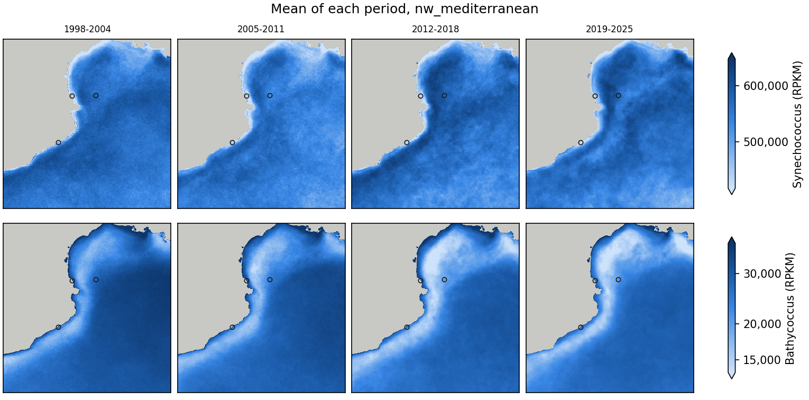
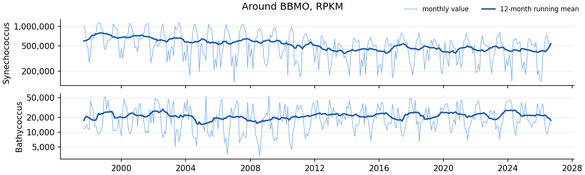

# Task 4 — 25 years of satellite records

*Technical note, draft. The part on plankton groups (section 2.6) will be rewritten with the
biodiversity indicator of Task 2.*

## Summary

The pigments that Task 1 retrieves from the 1 km multi-sensor record of the NW Mediterranean and
the north Adriatic (1997–2026) carry essentially two independent signals: biomass, and one axis of
composition. They reproduce the contrast between the coast (diatom pigments) and the open sea
(haptophyte, pelagophyte and cyanobacterial pigments), the late-winter bloom of the Catalan coast and
the river-driven years of the north Adriatic. From 2003 to 2025 the NW Mediterranean loses
chlorophyll a (−8% per decade) and fucoxanthin (−18%) while zeaxanthin rises (+5%), as satellite
functional types do over the Mediterranean (Martínez-Fornos et al., 2026); the north Adriatic has no
trend. Of the plankton groups of Task 2, only Synechococcus can be followed from these pigments, and
mostly as a low-chlorophyll signal. A step in the record around 2002–2003 (change of sensors), the
floor of the model near 0.1 mg m⁻³ of chlorophyll a and the poor retrieval of zeaxanthin at the
coast limit the trends and the composition signal.

## 1. Data and methods

- **Regions**: the NW Mediterranean (40.5–43.5 N, 1.5–5.5 E; stations BBMO, SOLA and MOLA) and the
  north Adriatic (44.5–45.85 N, 12.2–14.5 E; station VIDA).
- **Pigments**: the 13 pigments of the Task 1 model fine-tuned with satellite matchups, on the
  monthly means of the daily 1 km multi-sensor Rrs and on daily cubes around the stations
  ([Task 1](../task1/README.md)), checked against HPLC samples at the stations.
- **Plankton groups**: Synechococcus and Bathycoccus (pico, psbO), the PETRIMED models that hold
  from the satellite pigments once harmonized ([Task 2](../task2/README.md)).
- **Statistics**: months averaged from fewer than 3 days are left out; trends are log-linear fits of
  the annual values from 2003 to 2025 (see 3 for why 2003); the principal components are those of
  the ln pigments of the monthly maps.
- **Figures**: `python task4/scripts/figures.py` writes to `task4/figures/pigments/` and
  `task4/figures/psts/`, for every pigment or plankton group: the mean of each complete year
  (`<region>/<variable>_years.png`), the means of four periods of about seven years
  (`<region>/periods.png`) and the monthly series around each station (`stations/<station>.png`).
  The figures below are copies of some of them, in `task4/report/`.

## 2. Results

**2.1. The 13 pigments carry two signals.** In both regions, one principal component of the
monthly maps, with all pigments rising and falling with chlorophyll a, explains 81–83% of the
variance. A second one, 19'-hexanoyloxy- and 19'-butanoyloxyfucoxanthin against zeaxanthin,
explains 12–14%, and the other eleven 4–5%. This is about all that multispectral ocean colour can
give: satellite reflectances hold about two independent quantities, and the products derived from
them one (Cael et al., 2023), and in situ most diagnostic pigments follow chlorophyll a too (Hirata
et al., 2011). Diversity indicators computed from these pigments will mostly re-express
chlorophyll a plus one axis of composition, a caution that Martínez-Fornos et al. (2026) also make
for their satellite Shannon index.

**2.2. Diatoms on the coast, haptophytes and cyanobacteria offshore.** The share of fucoxanthin in
chlorophyll a is 3.2 times higher in the most productive waters (top 10% of chlorophyll a) than in
the least productive ones in the north Adriatic, and 2.2 times in the NW Mediterranean. Offshore,
the shares of 19'-hexanoyloxyfucoxanthin (7 and 2.4 times higher), 19'-butanoyloxyfucoxanthin and
zeaxanthin (4.7 and 2.3 times) are higher, zeaxanthin and 19'-hexanoyloxyfucoxanthin become the
main pigments after chlorophyll a, and in the NW Mediterranean the haptophyte and pelagophyte
pigments hardly follow chlorophyll a (r = 0.18 and −0.09). This matches the in situ picture: diatoms
make the blooms (Nunes et al., 2018), and haptophytes and prokaryotes are the main groups of the
open Mediterranean (Martínez-Fornos et al., 2026).

  
  

*The 13 pigments over four periods, NW Mediterranean (left) and north Adriatic (right). Circles
are the stations.*

**2.3. Late-winter bloom in Catalonia, autumn maximum in the Gulf of Trieste.** At BBMO, SOLA and
MOLA almost every pigment peaks between January and March and is lowest in July–August, except
zeaxanthin. Fucoxanthin varies 4 to 16 times over the year, zeaxanthin only 1.2 to 1.4 times (peak
in May), so the zeaxanthin share of chlorophyll a triples in summer (BBMO 0.11 → 0.32) while the
fucoxanthin share halves. The BBMO HPLC series shows the same winter–spring maxima and summer minima
(Nunes et al., 2018). At VIDA the haptophyte, dinoflagellate and diadinoxanthin pigments peak in
May, like the spring bloom of the Gulf of Trieste (Cerino et al., 2019), but chlorophyll a and
fucoxanthin peak in November, when the in situ counts rise only slightly. That autumn maximum may be
river water (sediment, coloured dissolved matter) read as pigment by the 5-band model: the VIDA data
of Task 3 can test it.

  
  

*Monthly pigments around BBMO (left) and VIDA (right), with their 12-month running mean.*

**2.4. NW Mediterranean: less chlorophyll, fewer diatoms, more cyanobacteria.** From 2003 to 2025
the regional chlorophyll a falls 8% per decade and fucoxanthin 18% (significant in 72% and 71% of
the pixels), while zeaxanthin rises 5% per decade (69% of the pixels). Relative to chlorophyll a,
zeaxanthin rises 16% per decade and 19'-hexanoyloxyfucoxanthin 6%, and fucoxanthin falls 10%. The
decline is gradual from about 2010, not a step. At BBMO, chlorophyll a falls 20% per decade and
fucoxanthin 33%. Satellite functional types over 2000–2025 give the same picture: chlorophyll
declining in all regions but the north Adriatic, most in the west, with falling shares of diatoms and
rising shares of prokaryotes and haptophytes (Martínez-Fornos et al., 2026). So does the BBMO HPLC
series, where most groups decrease as nutrients decrease (Nunes et al., 2018). One disagreement:
Martínez-Fornos et al. find green algae falling, while the share of chlorophyll b here rises
slightly (4% per decade).

**2.5. North Adriatic: years set by the Po, no trend.** The regional chlorophyll a varies from 0.40
to 0.93 mg m⁻³ between years, with all pigments together (median correlation 0.96) except
zeaxanthin. The lowest years, 2022, 2023, 2007 and 2003, include the two severe Po droughts of 2003
and 2022, and the highest are 2001, 1998, 2010, 2011 and 2024: satellite chlorophyll here follows
the Po discharge (Vona et al., 2025). From 2003 to 2025 there is no significant trend (chlorophyll a
−3% per decade, p = 0.6), as Martínez-Fornos et al. (2026) also find. The oligotrophication of the
north Adriatic measured in situ (Mozetič et al., 2010) was strongest in the decade to 2007, so part
of the drop between 1998–2002 and 2003–2007 here may be real. Only zeaxanthin rises (+4% per
decade, p = 0.001).

  

*Annual mean chlorophyll a in the north Adriatic: the Po plume, strong in 2001, 2010 and 2024 and
weak in 2003 and 2022.*

**2.6. Plankton groups: Synechococcus follows low chlorophyll (provisional).** Of the PETRIMED
plankton groups, only Synechococcus holds from the satellite pigments (Task 2). Around the three NW
Mediterranean stations it peaks in July and is 2.5 times lower in winter, as observed at BBMO (peak
in August), and its monthly values follow the satellite share of zeaxanthin (r = 0.55–0.71). But the
satellite zeaxanthin barely varies (coefficient of variation 0.11–0.17 at the stations, against
0.44–0.60 for chlorophyll a), so its share is almost the inverse of chlorophyll a (r = −0.97): the
indicator is mostly a low-chlorophyll, oligotrophy signal. It holds because Synechococcus follows
that signal too: at BBMO the observed Synechococcus goes with the HPLC share of zeaxanthin (r = 0.53)
and against chlorophyll a (r = −0.28). Bathycoccus peaks in winter (December–March), like the
prasinophytes at BBMO (Nunes et al., 2018), but the maps put it offshore rather than on the coast,
so only its seasonal cycle is usable. From 2003 to 2025 neither group changes significantly over the
regions (Synechococcus +1% per decade), while at BBMO Synechococcus falls 16% per decade. At VIDA,
Synechococcus peaks in May and goes against the zeaxanthin share (r = −0.66), a sign that the
models, made in the NW Mediterranean, do not hold there: the VIDA data of Task 3 will test it.

  
  

*Synechococcus and Bathycoccus (pico, psbO RPKM) from the satellite pigments: NW Mediterranean over
four periods (left) and monthly around BBMO (right).*

## 3. Limits

- *A step in 2002–2003.* From 1998–2002 to 2003–2007, chlorophyll a drops 13–30% at the four
  stations (alloxanthin up to 47%), and offshore zeaxanthin jumps in both regions (+17% for the
  regional median in the NW Mediterranean). It coincides with MODIS-Aqua and MERIS joining SeaWiFS,
  despite the inter-sensor correction of the product (Volpe et al., 2019), so the trends above start
  in 2003.
- *A floor near 0.1 mg m⁻³.* The model never gives chlorophyll a below about 0.1 mg m⁻³, while the
  most oligotrophic Mediterranean averages 0.06 mg m⁻³ (Martínez-Fornos et al., 2026): clear summer
  waters are overestimated and their trends damped.
- *Composition at the coast.* Against the HPLC samples of the stations (Task 1), the satellite
  chlorophyll a follows well (r = 0.78) but zeaxanthin does not (r = −0.05), the haptophyte and
  pelagophyte pigments only weakly (r = 0.38–0.45), and the highest values are missed: the
  composition signal of 2.1 is weaker at the coast than the biomass signal.
- *Few clear coastal pixels.* There are satellite data on 13% of the pixel-days around SOLA and 17%
  around BBMO, against 27% at VIDA and 50% at MOLA.

  

*Annual mean zeaxanthin in the NW Mediterranean: the offshore step between 2002 and 2003, then the
rise.*

## 4. Next steps

- Recompute the plankton part with the biodiversity indicator of Task 2, when PETRIMED provides it.
- Test pigments and plankton groups in the Gulf of Trieste with the VIDA data of Task 3.
- Compute trends per sensor period, or from 2003, until the step of 2002–2003 is explained.

## References

- Cael, B. B., Bisson, K., Boss, E. and Erickson, Z. K. (2023). How many independent quantities can
  be extracted from ocean color? *Limnology and Oceanography Letters*, 8(4), 603–610.
  https://doi.org/10.1002/lol2.10319
- Cerino, F. et al. (2019). Phytoplankton temporal dynamics in the coastal waters of the
  north-eastern Adriatic Sea (Mediterranean Sea) from 2010 to 2017. *Nature Conservation*, 34,
  343–372. https://doi.org/10.3897/natureconservation.34.30720
- Hirata, T. et al. (2011). Synoptic relationships between surface Chlorophyll-a and diagnostic
  pigments specific to phytoplankton functional types. *Biogeosciences*, 8, 311–327.
  https://doi.org/10.5194/bg-8-311-2011
- Martínez-Fornos, G., Di Cicco, A., Talone, M. and Berdalet, E. (2026). Trends of the
  phytoplankton functional diversity in the last 25 years in the Mediterranean Sea surface waters
  from satellite remote sensing. *Frontiers in Marine Science*, 13.
  https://doi.org/10.3389/fmars.2026.1892918
- Mozetič, P. et al. (2010). Recent trends towards oligotrophication of the northern Adriatic:
  evidence from chlorophyll a time series. *Estuaries and Coasts*, 33, 362–375.
  https://doi.org/10.1007/s12237-009-9191-7
- Nunes, S., Latasa, M., Gasol, J. M. and Estrada, M. (2018). Seasonal and interannual variability
  of phytoplankton community structure in a Mediterranean coastal site. *Marine Ecology Progress
  Series*, 592, 57–75. https://www.int-res.com/abstracts/meps/v592/p57-75/
- Ramond, P. et al. (in preparation). Inferring plankton biodiversity combining meta-omics and
  pigment data: a bridge towards satellite monitoring. Code: https://github.com/pjmramond/PETRIMED
- Volpe, G. et al. (2019). Mediterranean ocean colour Level 3 operational multi-sensor processing.
  *Ocean Science*, 15, 127–146. https://doi.org/10.5194/os-15-127-2019
- Vona, I., Colella, S., Sammartino, M., Brando, V. E. and Falcini, F. (2025). Positive correlation
  between the Po River discharge and ocean colour trends of Chl and TSM in the Adriatic Sea.
  *Frontiers in Remote Sensing*, 6. https://doi.org/10.3389/frsen.2025.1574347
